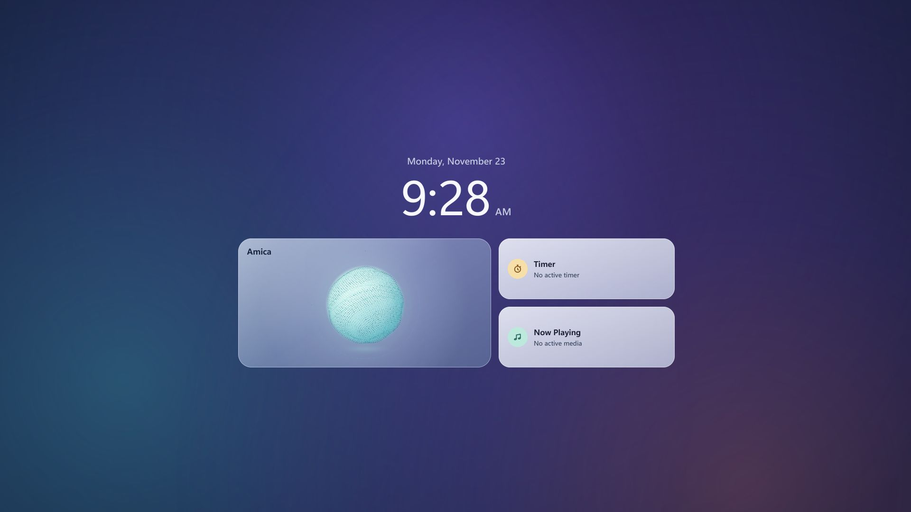

<div align="center">
  
  <h1>Project Amica</h1>
  <p><strong>A voice and chat companion for the Windows desktop.</strong></p>
  <p>Filipino, English, and Taglish · Memory maps · Timers and routines · Desktop controls</p>
  <p>
    
    
    
    
    
  </p>
  <p><a href="#overview">Overview</a> · <a href="#features">Features</a> · <a href="#quick-start">Quick start</a> · <a href="#local-data">Local data</a></p>
</div>


<p align="center"><em>The Amica home screen on Windows.</em></p>

## Overview

Amica brings conversation and everyday desktop tools into one Windows app. From Home, select **Type a message** to open chat or **Unmute microphone** to start a spoken conversation with Aoede. The orb reacts to voice activity, and you can explore saved memories in a map.

## Features

| Area | What you can do |
| --- | --- |
| Conversation | Chat with Gemini 3.5 Flash-Lite or speak in Filipino, English, or Taglish with Gemini 3.8 Live and the Aoede voice. |
| Memory | Revisit conversation history, save notes and preferences, and explore related memories in a map. |
| Daily tools | Check the clock and calendar, set timers and reminders, and manage tasks and routines. |
| Windows desktop | Launch apps, manage windows, and view system information. |
| Media and screensaver | Control media, open YouTube or Spotify panels, and choose a fullscreen screensaver. |



<p align="center"><em>The Dashboard screensaver shows the time, timer status, and currently playing media.</em></p>

## Quick start

Use Windows with the Rust MSVC toolchain and the Visual Studio Build Tools with **Desktop development with C++**. Voice requires a microphone and speakers or headphones. The embedded media panels require the Microsoft Edge WebView2 Runtime.

### 1. Clone the repository

```powershell
git clone https://github.com/maeven-tapa/project_amica.git
cd project_amica
```

### 2. Configure Gemini

Create a Gemini API key. Both configured models are available on the Gemini API free tier. [Google AI Studio](https://aistudio.google.com/apikey) · [Gemini API pricing](https://ai.google.dev/gemini-api/docs/pricing/)

Save the key in Windows Credential Manager from PowerShell 7.2 or later. The prompt masks the key as you type.

```powershell
Read-Host "Gemini API key" -MaskInput | cargo run --locked -- --set-gemini-key
```

For a key scoped to the current PowerShell session, use the environment variable instead.

```powershell
$env:GEMINI_API_KEY = Read-Host "Gemini API key" -MaskInput
```

### 3. Run Amica

```powershell
cargo run --locked
```

## Local data

On Windows, Amica stores conversation history, memories, and settings in `%LOCALAPPDATA%\Amica\chat.sqlite3`. Set `AMICA_DATA_DIR` to use a different data directory. **Private** conversations skip local chat history. Gemini still processes the text or audio you submit during a private session.
