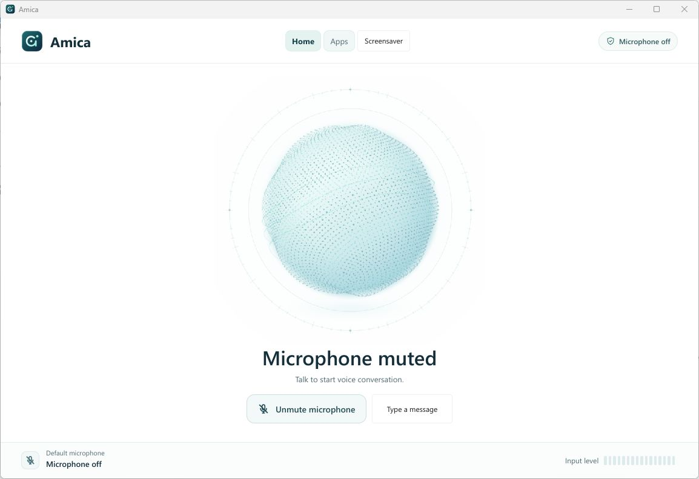

<div align="center">
  
  <h1>Project Amica</h1>
  <p><strong>A voice and chat companion for Windows and Raspberry Pi OS.</strong></p>
  <p>Filipino, English, and Taglish · Memory maps · Timers and routines · Desktop controls</p>
  <p>
    
    
    
    
    
    
  </p>
  <p><a href="#overview">Overview</a> · <a href="#features">Features</a> · <a href="#raspberry-pi-4">Raspberry Pi 4</a> · <a href="#quick-start">Windows quick start</a> · <a href="#local-data">Local data</a></p>
</div>



<p align="center"><em>The Amica home screen on Windows.</em></p>

## Overview

Amica brings conversation and everyday desktop tools into one app. From Home, select **Type a message** to open chat or **Unmute microphone** to start a spoken conversation with Aoede. The orb reacts to voice activity, and you can explore saved memories in a map.

## Features

| Area | What you can do |
| --- | --- |
| Conversation | Chat with Gemini 3.5 Flash-Lite or speak in Filipino, English, or Taglish with Gemini 3.8 Live and the Aoede voice. |
| Memory | Revisit conversation history, save notes and preferences, and explore related memories in a map. |
| Daily tools | Check the clock and calendar, set timers and reminders, and manage tasks and routines. |
| Desktop | Launch apps and view system information on either platform. Windows also supports controlling other app windows. |
| Media and screensaver | Control compatible media players and choose a fullscreen screensaver. YouTube and Spotify open in the browser on Linux and use embedded panels on Windows. |


<p align="center"><em>The Dashboard screensaver shows the time, timer status, and currently playing media.</em></p>

## Raspberry Pi 4

Use **Raspberry Pi OS (64-bit) with Desktop**. `dpkg --print-architecture` should print `arm64`. Run Amica from a terminal in the signed-in desktop session. For voice, connect a USB microphone or USB headset and select your input and output in Amica Settings. [Raspberry Pi OS downloads](https://www.raspberrypi.com/software/operating-systems/) · [Raspberry Pi audio guide](https://pip-assets.raspberrypi.com/categories/1259-audio-camera-and-display/documents/RP-008124-WP-1-Choosing%20an%20Audio%20option.pdf)

Install the build and desktop packages from the Pi terminal.

```bash
sudo apt update
sudo apt install build-essential curl git pkg-config libasound2-dev libfontconfig-dev \
  libwayland-client0 libwayland-cursor0 libxkbcommon0 fontconfig fonts-dejavu-core \
  libglib2.0-bin xdg-user-dirs playerctl libnotify-bin pulseaudio-utils pavucontrol \
  wlr-randr wdisplays x11-xserver-utils brightnessctl ddcutil
```

Install any missing launcher apps on Raspberry Pi OS Trixie. The Pi desktop image already includes some of these packages.

```bash
sudo apt install rpcc rp-prefapps gui-screenshot chromium galculator mousepad \
  mtpaint gpicview gnome-clocks network-manager-gnome blueman gnome-disk-utility
```

Install the current stable Rust toolchain. Amica needs Rust 1.95 or newer. If Rust is already installed through rustup, run `rustup update stable`. [Rustup installer](https://rustup.rs/)

Build the executable from the updated `project_amica` directory on the Pi.

```bash
cargo +stable build --locked --release -j 2
```

Create a Gemini key, then enter it at the hidden prompt in the same Bash terminal. [Google AI Studio](https://aistudio.google.com/apikey)

```bash
read -rsp 'Gemini API key: ' GEMINI_API_KEY
printf '\n'
export GEMINI_API_KEY
./target/release/amica
```

Without the key, you can still use local features such as timers and the screensaver. The Pi build uses `GEMINI_API_KEY` from the launch environment. Audio uses the desktop's PipeWire PulseAudio service when available, with ALSA as a fallback. [CPAL Linux audio documentation](https://github.com/RustAudio/cpal#linux-build-dependencies)

- The screensaver can start after idle time in the default labwc Wayland session. Use **Settings → Screensaver → Preview** to start it manually. [Raspberry Pi desktop configuration](https://www.raspberrypi.com/documentation/computers/configuration.html)
- Media control requires a player that exposes MPRIS. The current player can be paused, resumed, or queried from Amica. Browser playback and DRM depend on the installed browser.
- The command palette accepts Linux system commands such as `Set system volume to 35%`, `Switch audio output to HDMI`, `Show display resolution`, and `Open settings for display`. Start Desktop Control before changing system settings. App volume and mute require an active audio stream. Audio output changes select the system default.
- Brightness works with a controllable backlight or a DDC/CI monitor and I²C access. On labwc, `Set magnifier to 150%` applies display scaling when one display is active. GNOME uses its screen magnifier. Linux power actions depend on the device and desktop permissions.
- The Screenshot Tool shortcut opens the desktop screenshot app. External-window automation, saved window layouts, and Amica's window-specific capture commands are Windows features.

## Quick start

Use Windows with the Rust MSVC toolchain and the Visual Studio Build Tools with **Desktop development with C++**. Voice requires a microphone and speakers or headphones. The embedded media panels require the Microsoft Edge WebView2 Runtime.

### 1. Clone the repository

```powershell
git clone https://github.com/maeven-tapa/project_amica.git
cd project_amica
```

### 2. Configure Gemini

Create a Gemini API key. Both configured models are available on the Gemini API free tier. [Google AI Studio](https://aistudio.google.com/apikey) · [Gemini API pricing](https://ai.google.dev/gemini-api/docs/pricing/)

Save the key in Windows Credential Manager from PowerShell 7.2 or later. The prompt masks the key as you type.

```powershell
Read-Host "Gemini API key" -MaskInput | cargo run --locked -- --set-gemini-key
```

For a key scoped to the current PowerShell session, use the environment variable instead.

```powershell
$env:GEMINI_API_KEY = Read-Host "Gemini API key" -MaskInput
```

### 3. Run Amica

```powershell
cargo run --locked
```

## Local data

- Windows uses `%LOCALAPPDATA%\Amica\chat.sqlite3`.
- Linux uses `$XDG_DATA_HOME/amica/chat.sqlite3` when `XDG_DATA_HOME` is set to an absolute path, or `~/.local/share/amica/chat.sqlite3` by default.

Set `AMICA_DATA_DIR` to use a different data directory. **Private** conversations skip local chat history. Gemini still processes the text or audio you submit during a private session.
